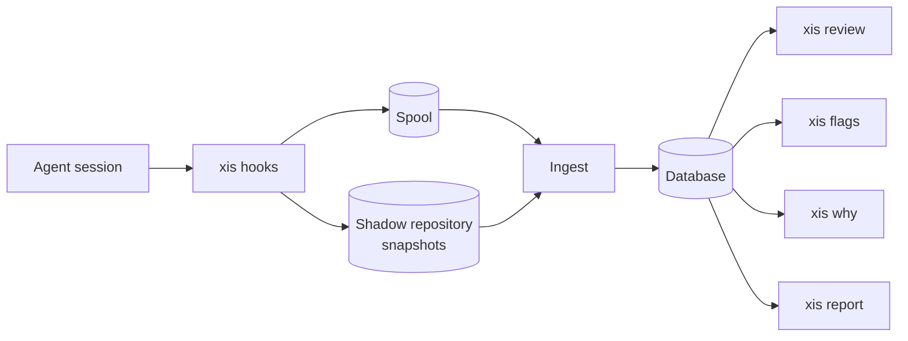

# xis

xis is a terminal tool that shows what an AI coding agent did to your code and why. It links each changed hunk to the step that made it. It also shows the instruction, the agent text and the evidence for that step.

xis flags risky behaviour with fixed rules, for example edited tests, changes out of scope and "tests pass" claims without a test run. The rules work without an LLM. An optional LLM can summarize the change and answer questions, but every statement must cite a step or a hunk.

## Overview

This diagram shows how data moves from the agent to the xis commands.



The agent calls the xis hooks at each step. The hooks write each event to the spool and take a snapshot of the working tree after each change. When the session stops, ingest reads the spool and the transcript. Ingest removes secrets and writes the session to the database. The commands read the database.

xis captures Claude Code sessions live through hooks. It imports Codex CLI sessions from their logs, with lower fidelity. Each session shows how xis captured it: `live` or `imported`.

## Install

With Homebrew:

```sh
brew install aaxis-em/tap/xis
```

With Go 1.26 or later:

```sh
go install github.com/aaxis-em/xis/cmd/xis@latest
```

xis needs git 2.31 or later. It is one static binary for Linux and macOS (amd64 and arm64). It also builds for Windows, but live capture supports only Linux and macOS.

## Quickstart

1. Run `xis init`. The command creates the config file, the database and the signing key.
2. Go to your repository.
3. Run `xis hook install --agent claude-code`. The command adds the hooks to `.claude/settings.json`.
4. Use Claude Code as usual.
5. Run `xis review` to walk through the change unit by unit.
6. Run `xis why FILE:LINE` to see the origin of one line.
7. Run `xis precommit install` to stop commits with high-severity flags.
8. After the commit, run `xis note write`. Then run `xis report --md` and paste the output into your pull request.

For a Codex CLI session, run `xis import codex --latest` in place of steps 3 and 4.

## Commands

| Command | Purpose |
| --- | --- |
| `xis init` | Create the directories, the config file and the signing key. |
| `xis hook install` / `uninstall` | Add or remove the Claude Code hooks. |
| `xis ingest` | Ingest the spooled sessions (the hooks do it automatically). |
| `xis import codex` | Import Codex CLI rollouts. |
| `xis sessions` | List the sessions of the repository. |
| `xis timeline [SESSION]` | Print the steps of a session. |
| `xis review [SESSION]` | Review a change in the terminal UI. |
| `xis why FILE:LINE` | Show the origin of one line. |
| `xis flags` | Run the rules. The exit code is 1 if flags at or above `--fail-on` exist. |
| `xis flags suppress ID --reason TEXT` | Accept one flag with a reason. |
| `xis precommit install` / `uninstall` | Add or remove the git pre-commit hook. |
| `xis analyze` | Run the LLM analysis: intent, review units and hunk explanations. |
| `xis ask "QUESTION"` | Ask a question; the answer cites steps and hunks. |
| `xis report --md` / `--json` | Write a summary for a pull request. |
| `xis note write` / `show` / `verify` | Attach, show or check the signed note of a commit. |
| `xis export agent-trace` | Export the change as an Agent Trace record. |
| `xis doctor` | Check the installation. |
| `xis gc` | Apply the retention settings. |
| `xis config get` / `set` / `path` | Show or change the config. |
| `xis version` | Show the version, the commit and the build date. |

Most commands select a change with these options: `SESSION`, `--staged`, `--range A..B` and `--pr`. See [docs/USAGE.md](docs/USAGE.md).

## How xis uses an LLM

The LLM is optional. Capture, attribution, the rules, `xis why`, `xis flags` and the pre-commit hook never use it.

With an LLM, `xis analyze` and `xis ask` add intent items, better review units, hunk explanations and answers. xis checks each result:

- Every sentence must cite a valid step or hunk. xis deletes the other sentences.
- An agent claim must be an exact quote of agent text near the edit. xis marks it `verified` only if the record proves it.
- xis caches each response and stops at the cost limit `llm.max_usd_per_change` (default 0.50 USD).

The default provider is `auto`: Anthropic if `ANTHROPIC_API_KEY` is set, else none. Each OpenAI-compatible server also works, for example OpenAI, Groq, Gemini, OpenRouter or Ollama. See [docs/CONFIG.md](docs/CONFIG.md). To turn off the LLM, run `xis config set llm.provider none`. For one command, set `XIS_LLM_PROVIDER=none`.

## Privacy

xis is local-first. It sends no telemetry.

- **What xis stores:** the redacted steps, tool calls, edits and test runs of each session, in `~/.local/share/xis/xis.db`. The snapshots are in a shadow git repository in the same directory. All files have mode `0600`.
- **What xis removes:** secrets (gitleaks rules, high-entropy tokens and your own patterns), before it stores data and again before each LLM call.
- **What leaves your machine:** nothing, unless you configure a remote LLM provider. Then xis sends only the steps and hunks that a task needs. With `llm.send_code = false`, it sends no file contents.

See [docs/PRIVACY.md](docs/PRIVACY.md) for the full data flow.

## Documents

- [Usage](docs/USAGE.md): each command with examples.
- [Architecture](docs/ARCHITECTURE.md): the design and the observed agent formats.
- [Rules](docs/RULES.md): each rule, its false positives and how to tune it.
- [Config](docs/CONFIG.md): every config key.
- [Privacy](docs/PRIVACY.md): data, redaction, retention and the LLM data flow.
- [Glossary](docs/GLOSSARY.md): the project terms.
- [Decisions](docs/DECISIONS.md): the decision log.
- [Contributing](CONTRIBUTING.md): build, test, fixtures, adapters and rules.
