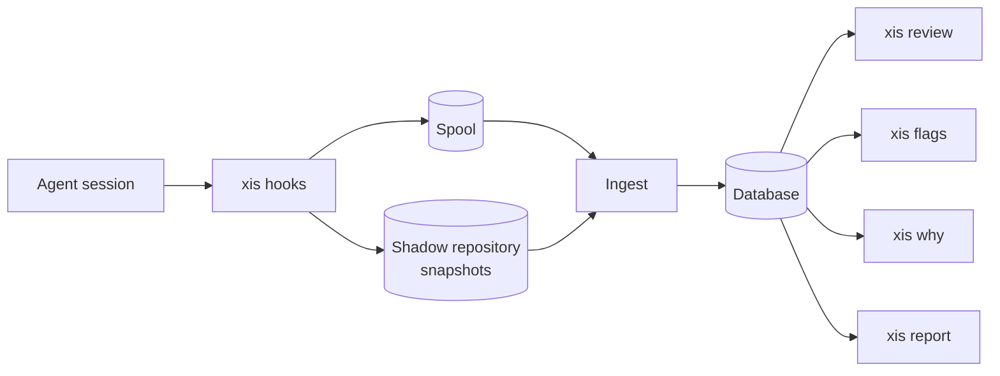

# xis

xis is a terminal tool that shows what an AI coding agent did to your code and why. It links each changed hunk to the step that made it. It also shows the instruction, the agent text and the evidence for that step.

xis flags risky behaviour with fixed rules, for example edited tests, changes out of scope and "tests pass" claims without a test run. The rules work without an LLM. An optional LLM can summarize the change and answer questions, but every statement must cite a step or a hunk.

> **Status:** xis is under development. This README grows with each milestone.

## Overview

This diagram shows how data moves from the agent to the xis commands.



The agent calls the xis hooks at each step. The hooks write each event to the spool and take a snapshot of the working tree after each change. When the session stops, ingest reads the spool and the transcript. Ingest removes secrets and writes the session to the database. The commands read the database.

## Install

```sh
go install github.com/aaxis-em/xis/cmd/xis@latest
```

## Documents

- [Usage](docs/USAGE.md)
- [Architecture](docs/ARCHITECTURE.md)
- [Rules](docs/RULES.md)
- [Config](docs/CONFIG.md)
- [Privacy](docs/PRIVACY.md)
- [Glossary](docs/GLOSSARY.md)
- [Decisions](docs/DECISIONS.md)
- [Contributing](CONTRIBUTING.md)
