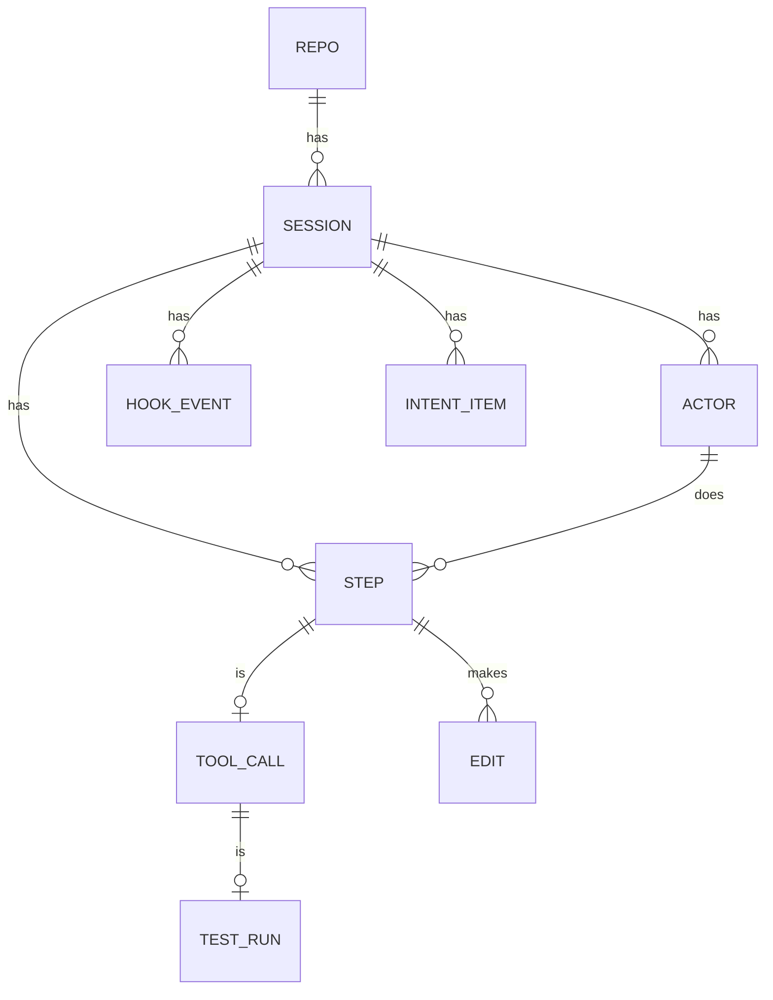
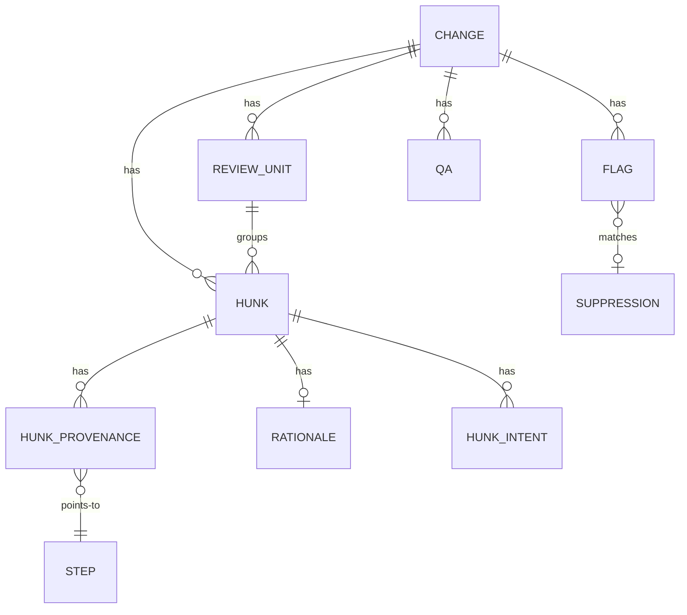

# Architecture

This document describes the design of xis. It uses the terms in the [glossary](GLOSSARY.md).

## Packages

| Package | Purpose |
| --- | --- |
| `cmd/xis` | The program entry point. |
| `internal/cli` | The cobra commands, flags and output. |
| `internal/config` | The config file, the defaults and the XDG paths. |
| `internal/xlog` | The rotating log file. |
| `internal/buildinfo` | The version, the commit and the build date. |
| `internal/tools/doclint` | The checker for the writing rules of the documents. |
| `internal/model` | The canonical types. |
| `internal/store` | The SQLite database and the migrations. |

## Data model

xis keeps all records in one SQLite database. The database uses WAL mode. All IDs are ULIDs. All times are UTC RFC 3339 text. Ingest makes the IDs of a session from stable input, so a second ingest of the same session keeps the same IDs.

This diagram shows the records of a session.

A session has steps. A step of kind `tool_call` has one tool call. A tool call that ran tests has one test run. Each edit belongs to the step that made the later snapshot.

This diagram shows the records of a change.

A change has hunks. Each hunk has provenance rows. A provenance row says how many lines of the hunk one step wrote. The step ID `unattributed` counts the lines that no captured step wrote.

A suppression matches a flag by its fingerprint. The fingerprint is the rule ID, the session and a stable key of the target, for example a file path. Thus a suppression stays when xis computes the flags again.

### Migrations

The migrations are SQL files in `internal/store/migrations`. xis applies them in name order when it opens the database. A schema change always goes in a new file.

| File | Content |
| --- | --- |
| `0001_init.sql` | The tables of Section 8 of the specification. |
| `0002_events_suppressions.sql` | The redacted hook events and the flag suppressions. |
