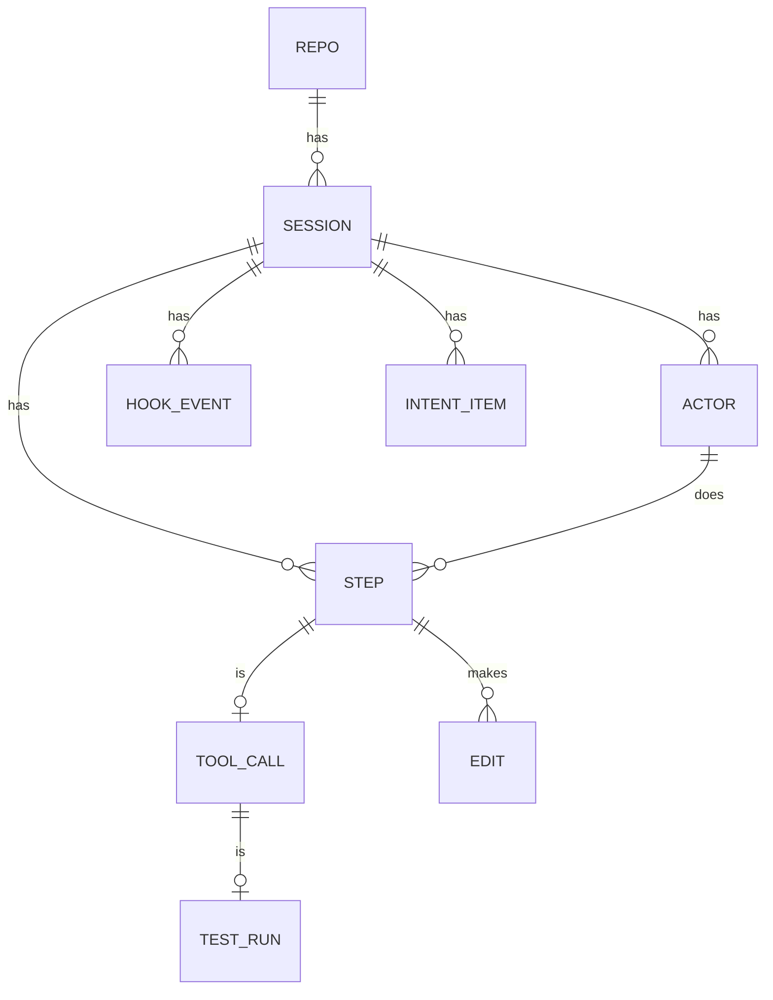
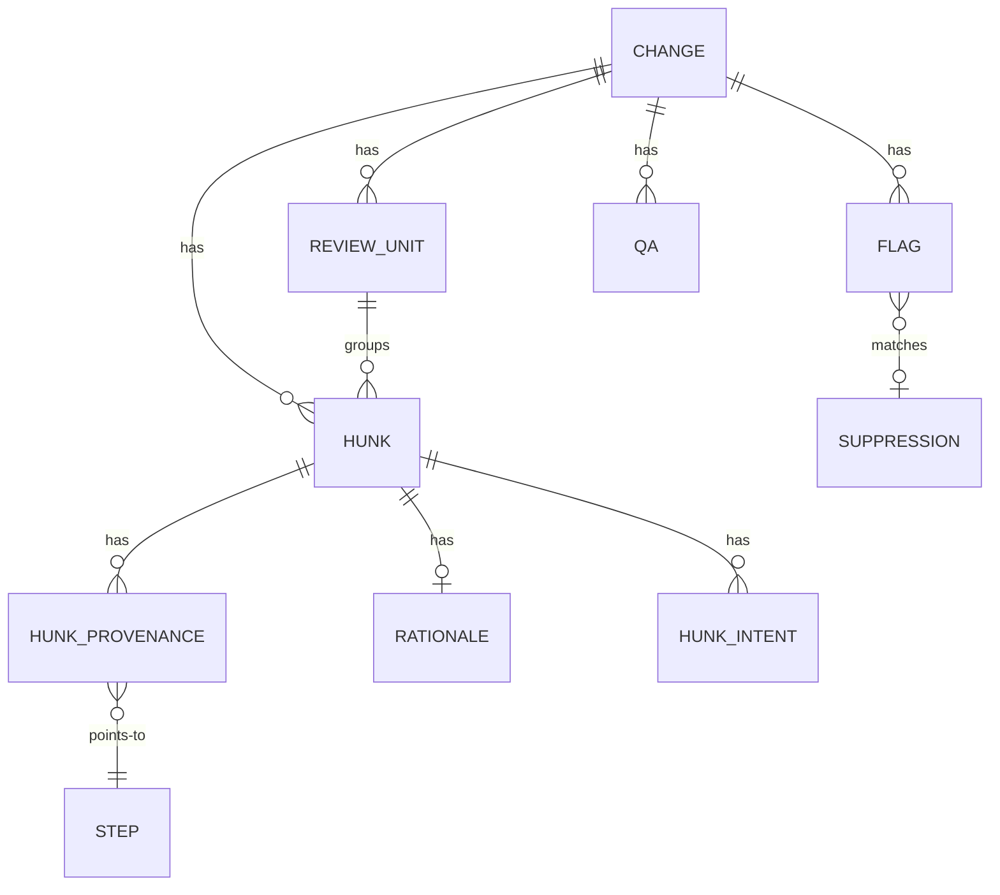
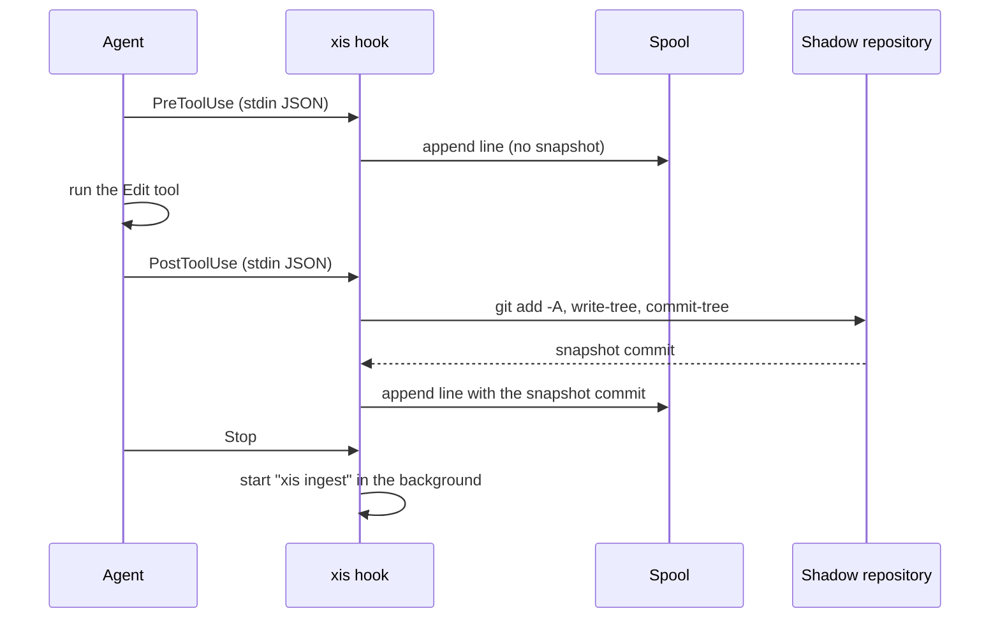

# Architecture

This document describes the design of xis. It uses the terms in the [glossary](GLOSSARY.md).

## Packages

| Package | Purpose |
| --- | --- |
| `cmd/xis` | The program entry point. |
| `internal/cli` | The cobra commands, flags and output. |
| `internal/config` | The config file, the defaults and the XDG paths. |
| `internal/xlog` | The rotating log file. |
| `internal/buildinfo` | The version, the commit and the build date. |
| `internal/tools/doclint` | The checker for the writing rules of the documents. |
| `internal/gitx` | The wrapper that runs the `git` binary with a timeout and a clean environment. |
| `internal/lockfile` | Advisory file locks (`flock`) for the spool and the snapshot chain. |
| `internal/snapshot` | The shadow repository and the snapshots. |
| `internal/capture` | The hook handler, the spool and the hook installation. |
| `internal/adapters/claudecode` | The Claude Code hook payload and transcript formats. |
| `internal/notes` | The signing key and (later) the git notes. |
| `internal/model` | The canonical types. |
| `internal/store` | The SQLite database and the migrations. |

## Data model

xis keeps all records in one SQLite database. The database uses WAL mode. All IDs are ULIDs. All times are UTC RFC 3339 text. Ingest makes the IDs of a session from stable input, so a second ingest of the same session keeps the same IDs.

This diagram shows the records of a session.



A session has steps. A step of kind `tool_call` has one tool call. A tool call that ran tests has one test run. Each edit belongs to the step that made the later snapshot.

This diagram shows the records of a change.



A change has hunks. Each hunk has provenance rows. A provenance row says how many lines of the hunk one step wrote. The step ID `unattributed` counts the lines that no captured step wrote.

A suppression matches a flag by its fingerprint. The fingerprint is the rule ID, the session and a stable key of the target, for example a file path. Thus a suppression stays when xis computes the flags again.

### Migrations

The migrations are SQL files in `internal/store/migrations`. xis applies them in name order when it opens the database. A schema change always goes in a new file.

| File | Content |
| --- | --- |
| `0001_init.sql` | The tables of Section 8 of the specification. |
| `0002_events_suppressions.sql` | The redacted hook events and the flag suppressions. |

## Capture

Claude Code runs `xis hook claude-code <Event>` for each hook event. The hook reads the event payload from stdin. It writes one line to the spool file of the session. After a tool call that can change files, the hook also takes a snapshot.

This diagram shows the capture of one `Edit` tool call.



The hook obeys these rules:

- The hook always exits with code 0. It never writes to stdout. It writes errors to the log file.
- The hook holds a lock for each session. Thus hooks of the same session (for example of subagents) run one at a time. The order of the spool lines is the order of the snapshot chain.
- If the working directory is not in a git repository, the hook records the event without a snapshot. The spool line has `"no_git": true`.
- On `Stop` and `SessionEnd`, the hook starts `xis ingest --session <id>` as a detached process and returns immediately.

Each spool line has this form:

```json
{"xis_v":1,"ts":"2026-10-20T13:58:41.123Z","event":"PostToolUse","payload":{...},"snapshot":"<shadow commit or null>","repo":{"id":"e360f8ac35ff0cd7","top":"/work/repo"}}
```

The hook copies the payload without change. Ingest removes secrets later. If the payload is not valid JSON, the hook stores it as a JSON string.

### Latency

The table shows the measured hook latency of the release binary on Linux (100 runs).

| Event | p50 | p95 | Budget |
| --- | --- | --- | --- |
| `PreToolUse` `Read` (no snapshot) | 3.2 ms | 3.8 ms | 50 ms |
| `PostToolUse` `Edit` (snapshot, small repository) | 19 ms | 21 ms | 500 ms |

`BenchmarkTake` in `internal/snapshot` takes a snapshot of a repository with 10,000 files. It takes about 26 ms. Run `make bench` to measure again.

## Snapshots

xis keeps one bare shadow repository for each user repository, at `shadow/<repo_id>.git`. The file `objects/info/alternates` of the shadow repository points to the object directory of the user repository. Thus the shadow repository does not copy blobs that the user repository has already.

To take a snapshot, xis runs `git add -A` and `git write-tree` in the working tree with these variables:

| Variable | Value |
| --- | --- |
| `GIT_INDEX_FILE` | `shadow/<repo_id>.git/index-<session_id>`, a private index |
| `GIT_OBJECT_DIRECTORY` | the object directory of the shadow repository |
| `GIT_ALTERNATE_OBJECT_DIRECTORIES` | the object directory of the user repository |

Then xis runs `git commit-tree` in the shadow repository and moves `refs/xis/sessions/<session_id>`. The first snapshot of a session has the `HEAD` commit of the user as its parent. Thus the chain starts in the real history.

xis never writes to the `.git` directory of the user. The snapshot respects `.gitignore`, and it includes untracked files. The patterns in `capture.exclude` remove more paths, for example `.env*`.

> **Caution:** Do not delete the shadow directory while a session runs. xis cannot attribute changes without it.

## Observed Claude Code formats

xis parses the formats that Claude Code 2.1.304 wrote on Linux in October 2026. The fixtures in `testdata/fixtures/claudecode` contain scrubbed real data.

### Hook payloads

All events have `session_id`, `transcript_path`, `cwd` and `hook_event_name`. The table shows the other fields.

| Event | Other fields |
| --- | --- |
| `SessionStart` | `source` (for example `startup`) |
| `UserPromptSubmit` | `prompt_id`, `permission_mode`, `prompt` |
| `PreToolUse` | `prompt_id`, `permission_mode`, `effort`, `tool_name`, `tool_input`, `tool_use_id`; `agent_id` and `agent_type` in a subagent |
| `PostToolUse` | as `PreToolUse`, plus `tool_response` and `duration_ms` |
| `PostToolUseFailure` | as `PreToolUse`, plus `error` (for example `"Exit code 1\n..."`), `is_interrupt` and `duration_ms` |
| `SubagentStart` | `agent_id`, `agent_type` |
| `SubagentStop` | `agent_id`, `agent_type`, `agent_transcript_path`, `last_assistant_message`, `stop_hook_active` |
| `Stop` | `last_assistant_message`, `stop_hook_active` |
| `SessionEnd` | `reason` |

The `tool_response` of `Bash` has `stdout`, `stderr` and `interrupted`. It has no exit code. A failed `Bash` call causes `PostToolUseFailure` instead of `PostToolUse`. The `error` field starts with `Exit code N`.

### Transcript

The transcript is a JSONL file. Each line has a `type`. xis reads these types and ignores all other types:

| `type` | Content that xis uses |
| --- | --- |
| `user` | `message.content` is a string (a prompt) or a list of blocks. A `tool_result` block has `tool_use_id`, `content` and `is_error`. `isMeta: true` marks text that the user did not type. |
| `assistant` | `message.model` and `message.content` blocks: `text`, `thinking` and `tool_use` (`id`, `name`, `input`). `message.usage` has the token counts. |
| `system` | `subtype`, for example `compact_boundary` or `stop_hook_summary`. |

Each entry has `uuid`, `parentUuid`, `timestamp`, `isSidechain`, `cwd`, `version` and `gitBranch`. The `thinking` text can be empty. Subagent transcripts are in `<session_id>/subagents/agent-<agent_id>.jsonl` next to the main transcript.
