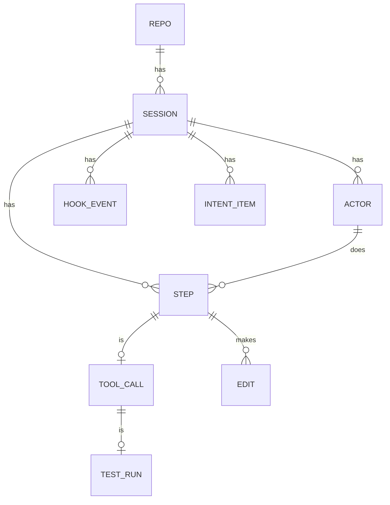
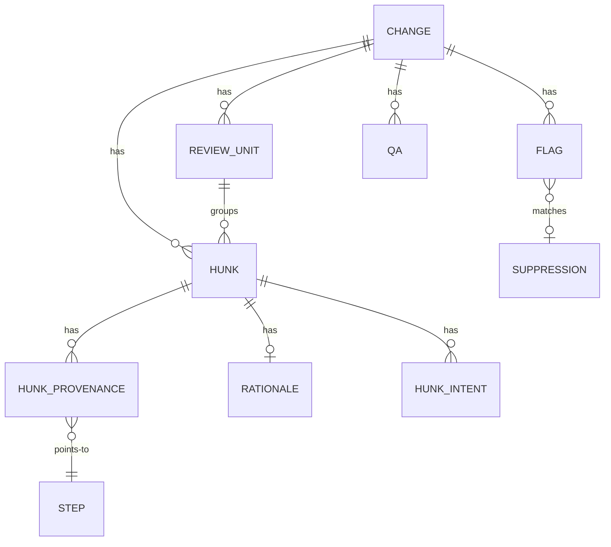
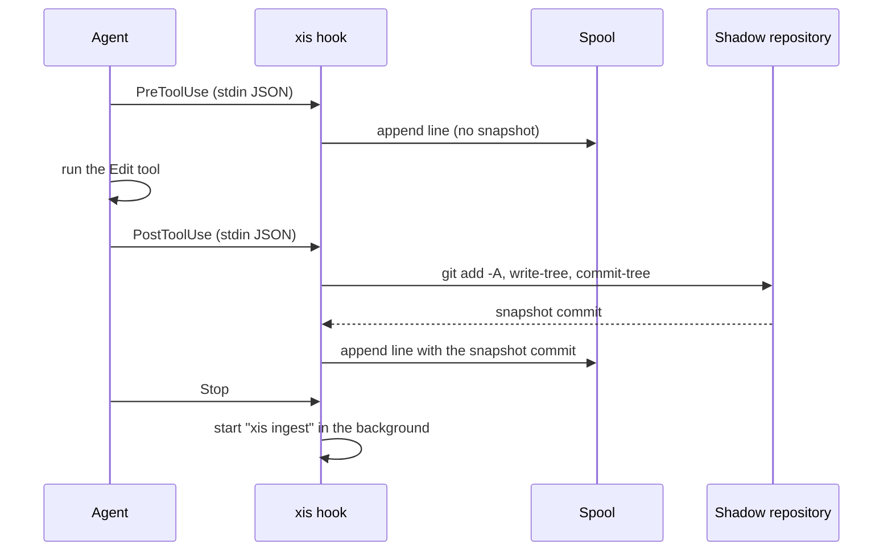
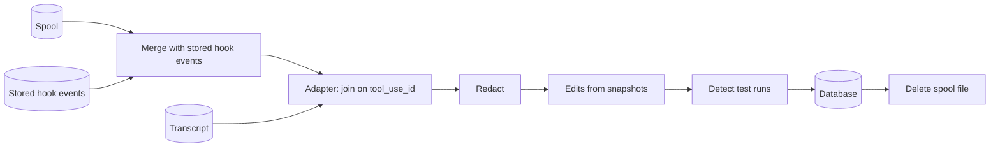
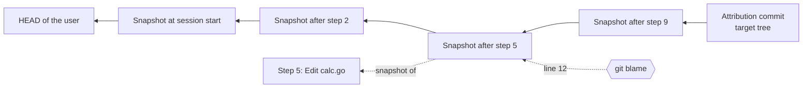

# Architecture

This document describes the design of xis. It uses the terms in the [glossary](GLOSSARY.md).

## Packages

| Package | Purpose |
| --- | --- |
| `cmd/xis` | The program entry point. |
| `internal/cli` | The cobra commands, flags and output. |
| `internal/config` | The config file, the defaults and the XDG paths. |
| `internal/xlog` | The rotating log file. |
| `internal/buildinfo` | The version, the commit and the build date. |
| `internal/tools/doclint` | The checker for the writing rules of the documents. |
| `internal/gitx` | The wrapper that runs the `git` binary with a timeout and a clean environment. |
| `internal/lockfile` | Advisory file locks (`flock`) for the spool and the snapshot chain. |
| `internal/snapshot` | The shadow repository and the snapshots. |
| `internal/capture` | The hook handler, the spool and the hook installation. |
| `internal/adapters/claudecode` | The Claude Code hook payload and transcript formats. |
| `internal/redact` | Secret detection (gitleaks rules, entropy, user patterns) and masking. |
| `internal/testdetect` | Test files, test commands, test outcomes and manifest files. |
| `internal/ingest` | The pipeline from the spool and the transcript to the database. |
| `internal/attribution` | Changes, hunks, provenance, change types and review units. |
| `internal/rules` | The rules engine, the 25 rules and the scope inference. |
| `internal/tui` | The review UI (bubbletea). |
| `internal/llm` | The provider interface (anthropic, openaicompat, mock), the cache and the budget guard. |
| `internal/analysis` | Intent, grouping, hunk explanations, the citation validator and the verification badges. The prompts are in `internal/analysis/prompts`. |
| `internal/qa` | The grounded answers of `xis ask`. |
| `internal/notes` | The signing key, the signed git notes and the Agent Trace export. |
| `internal/report` | The Markdown and JSON reports. |
| `internal/model` | The canonical types. |
| `internal/store` | The SQLite database and the migrations. |

## Data model

xis keeps all records in one SQLite database. The database uses WAL mode. All IDs are ULIDs. All times are UTC RFC 3339 text. Ingest makes the IDs of a session from stable input, so a second ingest of the same session keeps the same IDs.

This diagram shows the records of a session.



A session has steps. A step of kind `tool_call` has one tool call. A tool call that ran tests has one test run. Each edit belongs to the step that made the later snapshot.

This diagram shows the records of a change.



A change has hunks. Each hunk has provenance rows. A provenance row says how many lines of the hunk one step wrote. The step ID `unattributed` counts the lines that no captured step wrote.

A suppression matches a flag by its fingerprint. The fingerprint is the rule ID, the session and a stable key of the target, for example a file path. Thus a suppression stays when xis computes the flags again.

### Migrations

The migrations are SQL files in `internal/store/migrations`. xis applies them in name order when it opens the database. A schema change always goes in a new file.

| File | Content |
| --- | --- |
| `0001_init.sql` | The tables of Section 8 of the specification. |
| `0002_events_suppressions.sql` | The redacted hook events and the flag suppressions. |

## Capture

Claude Code runs `xis hook claude-code <Event>` for each hook event. The hook reads the event payload from stdin. It writes one line to the spool file of the session. After a tool call that can change files, the hook also takes a snapshot.

This diagram shows the capture of one `Edit` tool call.



The hook obeys these rules:

- The hook always exits with code 0. It never writes to stdout. It writes errors to the log file.
- The hook holds a lock for each session. Thus hooks of the same session (for example of subagents) run one at a time. The order of the spool lines is the order of the snapshot chain.
- If the working directory is not in a git repository, the hook records the event without a snapshot. The spool line has `"no_git": true`.
- On `Stop` and `SessionEnd`, the hook starts `xis ingest --session <id>` as a detached process and returns immediately.

Each spool line has this form:

```json
{"xis_v":1,"ts":"2026-10-20T13:58:41.123Z","event":"PostToolUse","payload":{...},"snapshot":"<shadow commit or null>","repo":{"id":"e360f8ac35ff0cd7","top":"/work/repo"}}
```

The hook copies the payload without change. Ingest removes secrets later. If the payload is not valid JSON, the hook stores it as a JSON string.

### Latency

The table shows the measured hook latency of the release binary on Linux (100 runs).

| Event | p50 | p95 | Budget |
| --- | --- | --- | --- |
| `PreToolUse` `Read` (no snapshot) | 3.2 ms | 3.8 ms | 50 ms |
| `PostToolUse` `Edit` (snapshot, small repository) | 19 ms | 21 ms | 500 ms |

`BenchmarkTake` in `internal/snapshot` takes a snapshot of a repository with 10,000 files. It takes about 26 ms. Run `make bench` to measure again.

## Snapshots

xis keeps one bare shadow repository for each user repository, at `shadow/<repo_id>.git`. The file `objects/info/alternates` of the shadow repository points to the object directory of the user repository. Thus the shadow repository does not copy blobs that the user repository has already.

To take a snapshot, xis runs `git add -A` and `git write-tree` in the working tree with these variables:

| Variable | Value |
| --- | --- |
| `GIT_INDEX_FILE` | `shadow/<repo_id>.git/index-<session_id>`, a private index |
| `GIT_OBJECT_DIRECTORY` | the object directory of the shadow repository |
| `GIT_ALTERNATE_OBJECT_DIRECTORIES` | the object directory of the user repository |

Then xis runs `git commit-tree` in the shadow repository and moves `refs/xis/sessions/<session_id>`. The first snapshot of a session has the `HEAD` commit of the user as its parent. Thus the chain starts in the real history.

xis never writes to the `.git` directory of the user. The snapshot respects `.gitignore`, and it includes untracked files. The patterns in `capture.exclude` remove more paths, for example `.env*`.

> **Caution:** Do not delete the shadow directory while a session runs. xis cannot attribute changes without it.

## Observed Claude Code formats

xis parses the formats that Claude Code 2.1.304 wrote on Linux in October 2026. The fixtures in `testdata/fixtures/claudecode` contain scrubbed real data.

### Hook payloads

All events have `session_id`, `transcript_path`, `cwd` and `hook_event_name`. The table shows the other fields.

| Event | Other fields |
| --- | --- |
| `SessionStart` | `source` (for example `startup`) |
| `UserPromptSubmit` | `prompt_id`, `permission_mode`, `prompt` |
| `PreToolUse` | `prompt_id`, `permission_mode`, `effort`, `tool_name`, `tool_input`, `tool_use_id`; `agent_id` and `agent_type` in a subagent |
| `PostToolUse` | as `PreToolUse`, plus `tool_response` and `duration_ms` |
| `PostToolUseFailure` | as `PreToolUse`, plus `error` (for example `"Exit code 1\n..."`), `is_interrupt` and `duration_ms` |
| `SubagentStart` | `agent_id`, `agent_type` |
| `SubagentStop` | `agent_id`, `agent_type`, `agent_transcript_path`, `last_assistant_message`, `stop_hook_active` |
| `Stop` | `last_assistant_message`, `stop_hook_active` |
| `SessionEnd` | `reason` |

The `tool_response` of `Bash` has `stdout`, `stderr` and `interrupted`. It has no exit code. A failed `Bash` call causes `PostToolUseFailure` instead of `PostToolUse`. The `error` field starts with `Exit code N`.

### Transcript

The transcript is a JSONL file. Each line has a `type`. xis reads these types and ignores all other types:

| `type` | Content that xis uses |
| --- | --- |
| `user` | `message.content` is a string (a prompt) or a list of blocks. A `tool_result` block has `tool_use_id`, `content` and `is_error`. `isMeta: true` marks text that the user did not type. |
| `assistant` | `message.model` and `message.content` blocks: `text`, `thinking` and `tool_use` (`id`, `name`, `input`). `message.usage` has the token counts. |
| `system` | `subtype`, for example `compact_boundary` or `stop_hook_summary`. |

Each entry has `uuid`, `parentUuid`, `timestamp`, `isSidechain`, `cwd`, `version` and `gitBranch`. The `thinking` text can be empty. Subagent transcripts are in `<session_id>/subagents/agent-<agent_id>.jsonl` next to the main transcript.

## Ingest

Ingest turns the hook events and the transcript of one session into canonical records.

This diagram shows the ingest pipeline.



The steps of the pipeline are:

1. Ingest reads the spool file. It adds the hook events that the database has already for the session. Thus a second ingest sees all events.
2. The adapter reads the transcript. The transcript gives the agent text, the reasoning, the prompts and the tool results. The hook events give the times and the snapshots. The adapter joins the two on `tool_use_id`. If the transcript is missing, the adapter uses the hook events only. Then the session status contains `no_transcript`.
3. Ingest removes secrets from all text, tool inputs, tool outputs and patches. It truncates tool output to `capture.max_output_bytes`.
4. For each pair of consecutive snapshots, ingest runs `git diff` in the shadow repository. The result is the edits of the step that made the later snapshot.
5. A snapshot at `UserPromptSubmit` that differs from the snapshot before it becomes a `human_edit` step. The user changed files between turns.
6. Ingest finds the shell tool calls that ran tests and parses their outcome.
7. Ingest writes all records in one transaction. Then it deletes the spool file.

Ingest makes all IDs from stable input. A second ingest of a session replaces its derived rows and keeps the same IDs.

### Test outcome

xis never guesses `pass`. The table shows how xis decides the outcome of a test run.

| Exit code | Summary line in the output | Outcome |
| --- | --- | --- |
| not 0 | none, pass or fail | `fail` |
| not 0 | error (for example `[setup failed]`) | `error` |
| 0 or none | fail, error or pass | the summary |
| 0 | none, and the command cannot hide the exit code | `pass` |
| 0 | none, and the command has `;`, `\|\|` or `\|` | `unknown` |
| none | none | `unknown` |

Claude Code gives no exit code for a successful `Bash` call. A failed call causes `PostToolUseFailure` with `Exit code N`. Thus xis takes 0 for a successful call that was not interrupted.

## Attribution

A change has a base and a target. The table shows the change options.

| Option | Base | Target | Sessions |
| --- | --- | --- | --- |
| (default) | `HEAD` at session start | the working tree | the given session or the latest session |
| `--staged` | `HEAD` | the index | the sessions that started on `HEAD` |
| `--range A..B` | `A` | `B` | the sessions that started on `A` or on a commit in `A..B` |
| `--pr` | the merge base with the default branch | `HEAD` | as `--range` |

To attribute the change, xis makes one more commit in the shadow repository, the attribution commit. Its tree is the target. Its parents are the final snapshots of the sessions. Then `git blame -w -M` on the attribution commit follows each line back through the snapshot chain.

This diagram shows how a line of a final hunk maps back to a step.



Each snapshot commit belongs to one step. Blame gives the commit that added each line. The commit gives the step. These rules apply:

- A line that blame gives to the attribution commit changed outside all captured steps. xis counts it as `unattributed`.
- A line that blame gives to the first snapshot or to the user history is not from a captured step. xis counts it as `unattributed`.
- A line from a `human_edit` step has the human as contributor.
- For a removed line, xis finds the first edit of the session that removed a line with the same text.
- A binary file or a file larger than `capture.max_file_bytes` gets no line attribution. xis gives the whole hunk to the last step that edited the file.

### Change type and review units

xis gives each hunk a change type with fixed rules. The first rule that matches wins. The order is `test` (test file), `generated`, `dependency` (manifests and lock files), `config` (CI and build files), `docs` and `refactor` (rename or whitespace only). All other hunks get `behavior`.

Without an LLM, xis groups the hunks by change type, then by top-level directory. The order is behavior, config, dependency, tests, refactor, docs and generated. The ID of a review unit comes from its group key. Thus the status of a unit stays when the change changes.

### Content hash

The content hash of a hunk is the Agent Trace range hash: `murmur3:` and 8 hex digits. xis hashes the added lines with 32-bit MurmurHash3 (seed 0). Before the hash, xis collapses whitespace in each line and joins the lines with `\n`.

## Review UI

The review UI is a bubbletea program in `internal/tui`. The command `xis review` computes the change, runs the rules and gives the UI one `Data` value. The UI does not read the database. It calls back to store the status of a unit and to ask a question.

The UI must stay fast with 2,000 hunks. It renders only the visible rows of each list. It highlights a hunk with chroma only when the hunk is on the screen, and it keeps the result in a cache.

## LLM layer

The LLM layer is optional. Capture, attribution, the rules, `xis why` and the pre-commit gate never use it.

All tasks use one `llm.Client`. The client checks the cache, then the budget guard, then calls the provider. It asks for JSON that matches a schema. If the response is not valid JSON, it asks again one time.

The evidence pack (`analysis.Pack`) gives each step, hunk and intent item a short alias, for example `s12`, `h3` and `i1`. The LLM cites the aliases. The validator maps them back to the real IDs and deletes each sentence without a valid citation. Thus the stored text has only real IDs that exist in the change.

For a long session (more than 60,000 characters of steps), xis first asks for a one-sentence summary of each step. Later tasks use the summaries for steps that are not near the hunk.

The prompts are Go constants with a version, for example `rationale-v1`. The version is part of the cache key, so a changed prompt never reuses old responses.

## Notes and signatures

`xis note write` computes the change `REF^..REF` and builds a note with hashes, counts and IDs only. The review counts come from the latest working-tree or index change of the same sessions, because you review before the commit exists.

To sign, xis removes the field `sig`, writes the JSON with sorted keys, and signs those bytes with ed25519. The note holds the public key. To verify, xis does the same steps and checks the signature. Thus a note verifies after any change of whitespace or key order, but not after a change of a value.

xis writes the note with `git notes --ref refs/notes/xis add -f`. This is the only write of xis to the user repository, together with the hooks that you install explicitly.
