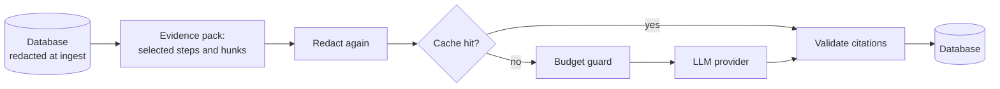

# Privacy

xis is local-first. It sends no telemetry. Data leaves your machine only if you configure a remote LLM provider.

## Data locations

| Data | Location | Mode |
| --- | --- | --- |
| Config | `~/.config/xis/config.toml` | `0600` |
| Database | `~/.local/share/xis/xis.db` | `0600` |
| Spool | `~/.local/share/xis/spool/<session>.jsonl` (raw hook events until ingest) | `0600` |
| Snapshots | `~/.local/share/xis/shadow/<repo>.git` | `0700` |
| Signing key | `~/.local/share/xis/keys/ed25519` | `0600` |
| Log | `~/.local/share/xis/logs/xis.log` (5 files of 5 MB) | `0600` |

xis creates all directories with mode `0700` and all files with mode `0600`.

On Windows, the config is in `%APPDATA%\xis` and the data is in `%LOCALAPPDATA%\xis`. Windows has no file modes. The access rules of your user profile protect these folders: by default, only you and the administrators can read them.

## Log

By default the log contains only event names, session IDs and tool use IDs. It never contains payloads or tool output.

## Snapshots

A snapshot contains the files of the working tree, without the ignored files and without the paths in `capture.exclude`. The default `capture.exclude` removes `.env*`, `*.pem`, `*.key`, `id_rsa*` and `*.p12` files.

## Redaction

Ingest removes secrets before it writes to the database. It removes secrets again before each LLM call. xis finds secrets in three ways:

- The gitleaks rules (for example AWS, GitHub, Anthropic and OpenAI keys, and private key blocks).
- An entropy check. It finds tokens of 20 characters or more with letters, digits and a Shannon entropy of 4.5 bits per character or more. It ignores alphabet strings, in which half of the characters follow the previous character, for example `abc...xyz0123456789`.
- The regular expressions in `redact.patterns`.

xis replaces each secret with `[REDACTED:<rule>:<hash>]`. The hash is the first 4 hex digits of the SHA-256 of the secret. Thus the same secret has the same token in all records of a session.

## Spool files

The spool file of a session holds the raw hook events until ingest. Ingest deletes the file after success. The database keeps a redacted copy of each hook event. xis truncates large tool responses in that copy to `capture.max_output_bytes`.

## LLM data flow

xis sends data to an LLM provider only if you configure one. With `llm.provider = none` (the default without an API key), no data leaves your machine.

This diagram shows the path of session data to an LLM provider.

These rules apply to each call:

- xis sends only the steps and hunks that the task needs, never the whole transcript.
- xis removes secrets at ingest, and again before each call.
- With `llm.send_code = false`, xis sends no file contents and no tool output.
- xis puts all session text in labelled blocks. The system prompt tells the model that the text is untrusted data and that it must ignore instructions in it. The analysis call has no tools.
- xis stores each response in the local cache. The cache files have mode `0600`.
