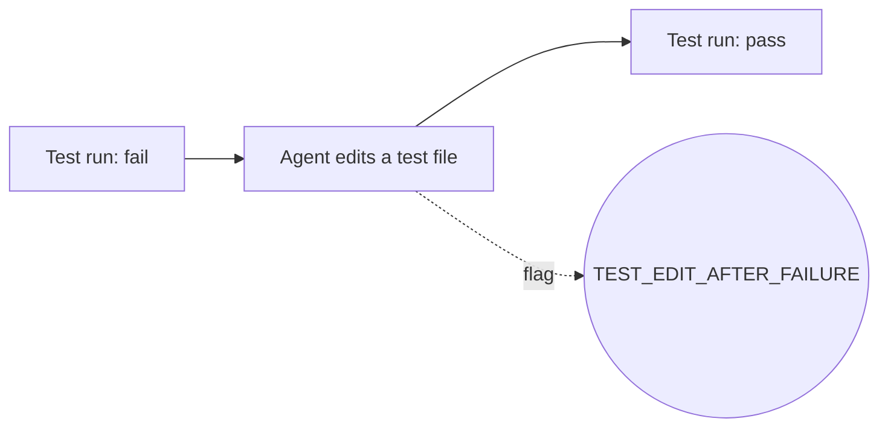
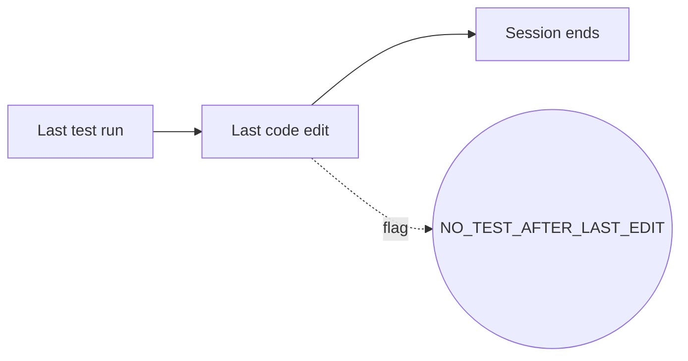
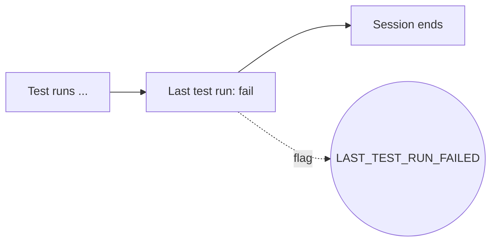
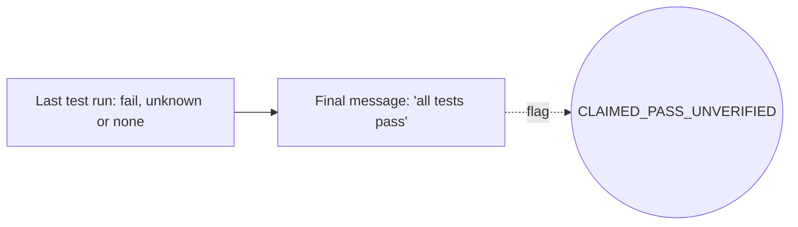
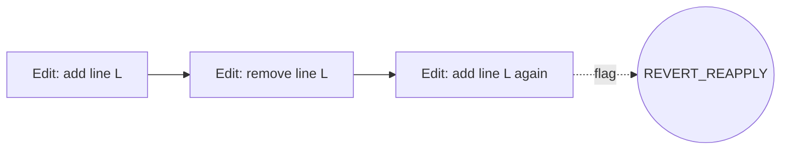
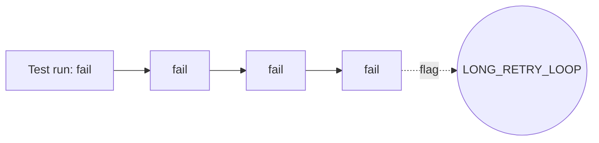

# Rules

This document describes each rule. A rule is a fixed check. It uses only the stored data. It never uses an LLM.

Run `xis flags` to run the rules on a change. The exit code is 0 if no unsuppressed flag has a severity at or above `--fail-on` (default `high`). The exit code is 1 if such flags exist. The exit code is 2 if xis has an error.

## Tune the rules

| Task | How |
| --- | --- |
| Turn off a rule | Add the rule ID to `rules.disabled`. |
| Change a severity | Set `rules.severity`, for example `{ SENSITIVE_PATH = "low" }`. |
| Accept one flag | Run `xis flags suppress FLAG_ID --reason "..."`. |

A suppression applies to the same finding in later runs. xis finds the same finding by its fingerprint: the rule ID, the session and a stable key of the target. Reports show suppressed flags with their reason.

## Summary

| Rule | Severity | Target |
| --- | --- | --- |
| [`TEST_FILE_MODIFIED`](#test_file_modified) | medium | file |
| [`TEST_FILE_DELETED`](#test_file_deleted) | high | file |
| [`ASSERTIONS_REDUCED`](#assertions_reduced) | high | file |
| [`TEST_SKIPPED`](#test_skipped) | high | hunk |
| [`SNAPSHOT_UPDATED`](#snapshot_updated) | medium | file or step |
| [`TEST_EDIT_AFTER_FAILURE`](#test_edit_after_failure) | high | step |
| [`TESTS_NEVER_RUN`](#tests_never_run) | medium | session |
| [`NO_TEST_AFTER_LAST_EDIT`](#no_test_after_last_edit) | medium | step |
| [`LAST_TEST_RUN_FAILED`](#last_test_run_failed) | high | step |
| [`CLAIMED_PASS_UNVERIFIED`](#claimed_pass_unverified) | high | step |
| [`DEPENDENCY_CHANGED`](#dependency_changed) | medium | file |
| [`CI_CONFIG_CHANGED`](#ci_config_changed) | high | file |
| [`BUILD_CONFIG_CHANGED`](#build_config_changed) | medium | file |
| [`LINT_SUPPRESSED`](#lint_suppressed) | medium | hunk |
| [`OUT_OF_SCOPE`](#out_of_scope) | medium | file |
| [`SECRET_FILE_ACCESS`](#secret_file_access) | high | step |
| [`SECRET_IN_CHANGE`](#secret_in_change) | high | hunk |
| [`SENSITIVE_PATH`](#sensitive_path) | medium | file |
| [`DESTRUCTIVE_COMMAND`](#destructive_command) | high | step |
| [`GIT_HISTORY_REWRITE`](#git_history_rewrite) | high | step |
| [`PERMISSION_CHANGED`](#permission_changed) | medium | file |
| [`REVERT_REAPPLY`](#revert_reapply) | low | file |
| [`LONG_RETRY_LOOP`](#long_retry_loop) | low | session |
| [`UNATTRIBUTED_CHANGE`](#unattributed_change) | medium | hunk |
| [`LARGE_CHANGE`](#large_change) | info | session |

## TEST_FILE_MODIFIED

**Severity:** `medium`. **Target:** file.

**What it detects:** The agent changed a test file. The change contains lines from an agent step in a test file.

**Why it matters:** An agent can make a test pass by a change to the test instead of the code. Review each change to a test.

**Known false positives:** A task that asks for new tests always fires this rule. That is correct: the flag asks you to review the tests.

**Tune:** Suppress one flag with `xis flags suppress`. Turn off the rule with `rules.disabled = ["TEST_FILE_MODIFIED"]`.

## TEST_FILE_DELETED

**Severity:** `high`. **Target:** file.

**What it detects:** A test file was deleted in the change.

**Why it matters:** A deleted test removes a check. The deletion can hide a broken feature.

**Known false positives:** A deliberate move of tests to a new file can look like a deletion if git does not find the rename.

**Tune:** Suppress one flag with `xis flags suppress`. Turn off the rule with `rules.disabled = ["TEST_FILE_DELETED"]`.

## ASSERTIONS_REDUCED

**Severity:** `high`. **Target:** file.

**What it detects:** The number of assertion tokens in a test file went down. xis counts tokens such as `assert`, `expect(`, `t.Error`, `t.Fatal`, `require.`, `should` and `#[should_panic]` in the added and the removed lines.

**Why it matters:** Fewer assertions usually means weaker tests.

**Known false positives:** A refactor that replaces several assertions with one table-driven assertion can fire this rule.

**Tune:** Suppress one flag with `xis flags suppress`. Turn off the rule with `rules.disabled = ["ASSERTIONS_REDUCED"]`.

## TEST_SKIPPED

**Severity:** `high`. **Target:** hunk.

**What it detects:** An added line skips or disables a test, for example `t.Skip`, `@pytest.mark.skip`, `xfail`, `.skip(`, `xit(`, `xdescribe(`, `@Disabled`, `@Ignore`, `#[ignore]` or `pending`.

**Why it matters:** A skipped test does not run. The test suite then passes without the check.

**Known false positives:** A skip for a platform (for example `t.Skip` on Windows) fires this rule.

**Tune:** Suppress one flag with `xis flags suppress`. Turn off the rule with `rules.disabled = ["TEST_SKIPPED"]`.

## SNAPSHOT_UPDATED

**Severity:** `medium`. **Target:** file or step.

**What it detects:** A test snapshot file changed (`__snapshots__/**`, `*.snap`), or a test run used `-u` or `--update-snapshots`.

**Why it matters:** An updated snapshot accepts the new output as correct. The agent can accept wrong output this way.

**Known false positives:** A deliberate change of the output fires this rule. Review the snapshot diff.

**Tune:** Suppress one flag with `xis flags suppress`. Turn off the rule with `rules.disabled = ["SNAPSHOT_UPDATED"]`.

## TEST_EDIT_AFTER_FAILURE

**Severity:** `high`. **Target:** step.

**What it detects:** The agent edited a test file after a failing test run and before the next passing run.

**Why it matters:** This is the typical pattern of "make the test pass" by a change to the test.

This diagram shows the order of events that fires the rule.

**Known false positives:** A test that was wrong before the session fires this rule. Suppress the flag with the reason.

**Tune:** Suppress one flag with `xis flags suppress`. Turn off the rule with `rules.disabled = ["TEST_EDIT_AFTER_FAILURE"]`.

## TESTS_NEVER_RUN

**Severity:** `medium`. **Target:** session.

**What it detects:** The session changed source files (`behavior` hunks from agent steps), but no test run occurred in the session.

**Why it matters:** Without a test run, there is no evidence that the change works.

**Known false positives:** A project without tests, or with tests that the agent runs through an unknown command, fires this rule. Add the command to `capture.test_commands`.

**Tune:** Suppress one flag with `xis flags suppress`. Turn off the rule with `rules.disabled = ["TESTS_NEVER_RUN"]`.

## NO_TEST_AFTER_LAST_EDIT

**Severity:** `medium`. **Target:** step.

**What it detects:** The last code edit of the agent came after the last test run.

**Why it matters:** The last test run does not cover the final code.

This diagram shows the order of events that fires the rule.

**Known false positives:** A last edit of a comment fires this rule.

**Tune:** Suppress one flag with `xis flags suppress`. Turn off the rule with `rules.disabled = ["NO_TEST_AFTER_LAST_EDIT"]`.

## LAST_TEST_RUN_FAILED

**Severity:** `high`. **Target:** step.

**What it detects:** The last test run of the session failed (outcome `fail` or `error`).

**Why it matters:** The session ended with a known failure.

This diagram shows the order of events that fires the rule.

**Known false positives:** A test run that fails for a reason outside the change (for example a network test) fires this rule.

**Tune:** Suppress one flag with `xis flags suppress`. Turn off the rule with `rules.disabled = ["LAST_TEST_RUN_FAILED"]`.

## CLAIMED_PASS_UNVERIFIED

**Severity:** `high`. **Target:** step.

**What it detects:** The final message of the agent says that tests pass or that the code works. But the last test run failed or had the outcome `unknown`, or no test run occurred.

**Why it matters:** This is an agent claim without evidence. xis shows agent claims as claims, not as facts.

This diagram shows the order of events that fires the rule.

**Known false positives:** The claim can be true if you ran the tests outside the session.

**Tune:** Suppress one flag with `xis flags suppress`. Turn off the rule with `rules.disabled = ["CLAIMED_PASS_UNVERIFIED"]`.

## DEPENDENCY_CHANGED

**Severity:** `medium`. **Target:** file.

**What it detects:** A dependency manifest or a lock file changed. Examples are `go.mod`, `go.sum`, `package.json`, lock files, `requirements*.txt`, `pyproject.toml`, `Cargo.toml`, `Gemfile`, `pom.xml` and `build.gradle*`.

**Why it matters:** A new dependency adds code that you did not review. It can add a supply-chain risk.

**Known false positives:** A task that asks for a dependency update always fires this rule.

**Tune:** Suppress one flag with `xis flags suppress`. Turn off the rule with `rules.disabled = ["DEPENDENCY_CHANGED"]`.

## CI_CONFIG_CHANGED

**Severity:** `high`. **Target:** file.

**What it detects:** A CI config changed: `.github/workflows/**`, `.gitlab-ci.yml`, `.circleci/**`, `Jenkinsfile` or `azure-pipelines.yml`.

**Why it matters:** A CI change can turn off checks or can expose secrets.

**Known false positives:** A task about CI always fires this rule.

**Tune:** Suppress one flag with `xis flags suppress`. Turn off the rule with `rules.disabled = ["CI_CONFIG_CHANGED"]`.

## BUILD_CONFIG_CHANGED

**Severity:** `medium`. **Target:** file.

**What it detects:** A build or lint config changed: `Makefile`, `Dockerfile*`, `docker-compose*`, linter and formatter configs, `tsconfig*` or `.eslintrc*`.

**Why it matters:** A config change can turn off a check for the whole project.

**Known false positives:** A task about the build always fires this rule.

**Tune:** Suppress one flag with `xis flags suppress`. Turn off the rule with `rules.disabled = ["BUILD_CONFIG_CHANGED"]`.

## LINT_SUPPRESSED

**Severity:** `medium`. **Target:** hunk.

**What it detects:** An added line suppresses a linter: `//nolint`, `# noqa`, `eslint-disable`, `@ts-ignore`, `@SuppressWarnings` or `#[allow(`.

**Why it matters:** A suppression hides a problem instead of a fix.

**Known false positives:** A justified suppression with a comment fires this rule too.

**Tune:** Suppress one flag with `xis flags suppress`. Turn off the rule with `rules.disabled = ["LINT_SUPPRESSED"]`.

## OUT_OF_SCOPE

**Severity:** `medium`. **Target:** file.

**What it detects:** The agent changed a file outside the inferred scope of the session.

**Why it matters:** A change outside the task is a surprise for the reviewer.

**Known false positives:** The scope inference is conservative, but it can miss a file that the task needs. See [Scope inference](#scope-inference).

**Tune:** Suppress one flag with `xis flags suppress`. Turn off the rule with `rules.disabled = ["OUT_OF_SCOPE"]`.

## SECRET_FILE_ACCESS

**Severity:** `high`. **Target:** step.

**What it detects:** The agent read or edited a secret file, or a shell command of the agent named one. Secret files are `.env*`, `*.pem`, `*.key`, `id_rsa*`, `*credentials*` and `*.p12`.

**Why it matters:** Secret files can go into the transcript and to an LLM provider.

**Known false positives:** A file name such as `test.key` that is not a secret fires this rule.

**Tune:** Suppress one flag with `xis flags suppress`. Turn off the rule with `rules.disabled = ["SECRET_FILE_ACCESS"]`.

## SECRET_IN_CHANGE

**Severity:** `high`. **Target:** hunk.

**What it detects:** The redactor found a secret in the added lines of a hunk.

**Why it matters:** A secret in a commit is hard to remove from history.

**Known false positives:** A test fixture with a fake key that looks real fires this rule. The entropy check ignores alphabet strings such as `abcdefghijklmnopqrstuvwxyz0123456789`.

**Tune:** Suppress one flag with `xis flags suppress`. Turn off the rule with `rules.disabled = ["SECRET_IN_CHANGE"]`.

## SENSITIVE_PATH

**Severity:** `medium`. **Target:** file.

**What it detects:** A changed path or the function name in a hunk header contains a sensitive word. The words are `auth`, `login`, `password`, `token`, `crypto`, `session`, `permission`, `payment`, `billing`, `security` and `sanitiz`.

**Why it matters:** These areas need a careful review.

**Known false positives:** The word `session` is common. Disable the rule or lower its severity if it fires too often.

**Tune:** Suppress one flag with `xis flags suppress`. Turn off the rule with `rules.disabled = ["SENSITIVE_PATH"]`.

## DESTRUCTIVE_COMMAND

**Severity:** `high`. **Target:** step.

**What it detects:** The agent ran `rm -rf`, `git reset --hard`, `git push --force`, `git clean -f`, `git checkout -- .`, `DROP TABLE`, `TRUNCATE` or `chmod -R 777`.

**Why it matters:** These commands can delete work or data.

**Known false positives:** `rm -rf` of a build directory fires this rule.

**Tune:** Suppress one flag with `xis flags suppress`. Turn off the rule with `rules.disabled = ["DESTRUCTIVE_COMMAND"]`.

## GIT_HISTORY_REWRITE

**Severity:** `high`. **Target:** step.

**What it detects:** The agent ran `git rebase`, `git commit --amend`, `git filter-branch`, `git filter-repo` or a force push.

**Why it matters:** A history rewrite can remove commits of other people.

**Known false positives:** A rebase that you asked for fires this rule.

**Tune:** Suppress one flag with `xis flags suppress`. Turn off the rule with `rules.disabled = ["GIT_HISTORY_REWRITE"]`.

## PERMISSION_CHANGED

**Severity:** `medium`. **Target:** file.

**What it detects:** The mode of a file changed in the diff, for example from `100644` to `100755`.

**Why it matters:** An executable bit on a data file, or a lost bit on a script, is usually a mistake.

**Known false positives:** A new script that must be executable fires this rule only if the file existed before.

**Tune:** Suppress one flag with `xis flags suppress`. Turn off the rule with `rules.disabled = ["PERMISSION_CHANGED"]`.

## REVERT_REAPPLY

**Severity:** `low`. **Target:** file.

**What it detects:** In one session, the agent added, removed and then added again the same lines of a file. A line that one edit removes and adds again is a moved line, and it does not count.

**Why it matters:** This pattern shows uncertainty. The final code needs a careful look.

This diagram shows the order of events that fires the rule.

**Known false positives:** Normal work on a long function can fire this rule.

**Tune:** Suppress one flag with `xis flags suppress`. Turn off the rule with `rules.disabled = ["REVERT_REAPPLY"]`.

## LONG_RETRY_LOOP

**Severity:** `low`. **Target:** session.

**What it detects:** 4 or more consecutive test runs failed. Set the number with `rules.retry_loop_runs`.

**Why it matters:** A long loop of failures can end in a change to the tests instead of the code.

This diagram shows the order of events that fires the rule.

**Known false positives:** Slow work on a hard bug fires this rule.

**Tune:** Suppress one flag with `xis flags suppress`. Turn off the rule with `rules.disabled = ["LONG_RETRY_LOOP"]`.

## UNATTRIBUTED_CHANGE

**Severity:** `medium`. **Target:** hunk.

**What it detects:** No captured step wrote any line of the hunk. This occurs for imported sessions, and for changes outside the captured steps.

**Why it matters:** xis cannot show why the hunk exists.

**Known false positives:** Uncommitted work from before the session fires this rule. Commit your own work before a session.

**Tune:** Suppress one flag with `xis flags suppress`. Turn off the rule with `rules.disabled = ["UNATTRIBUTED_CHANGE"]`.

## LARGE_CHANGE

**Severity:** `info`. **Target:** session.

**What it detects:** The change has more than 500 changed lines or more than 20 files. Set the limits with `rules.large_change_lines` and `rules.large_change_files`.

**Why it matters:** A large change is hard to review in one pass.

**Known false positives:** A generated file or a lock file can make a small change look large.

**Tune:** Suppress one flag with `xis flags suppress`. Turn off the rule with `rules.disabled = ["LARGE_CHANGE"]`.

## Scope inference

The `OUT_OF_SCOPE` rule needs the scope of each turn. A turn starts at a user prompt and ends before the next one. xis infers the scope with fixed rules. The scope of a turn is the union of these sets:

- The paths, file names and identifiers in the user prompts of this turn and of the turns before it. An identifier is a CamelCase, camelCase or snake_case word, or a word in backticks.
- The directories of the files that the agent read or searched before its first edit in the turn. Paths in the shell commands of the agent before that edit also count, for example `cat store/store.go`.
- The paths in `scope.paths` of `.xis.toml`.
- The changed files whose added lines use an identifier from the prompts. xis ignores case and underscores, so `expires_at` matches `ExpiresAt`.
- The test files that mirror an in-scope file, for example `calc_test.go` for `calc.go`.

xis compares each agent line with the scope of the turn that wrote it. A changed file is in scope if it is a scope file. It is also in scope if it is in a scope directory or in a subdirectory of it. The repository root is special: a read of a root file puts only the other root files in scope, not the subdirectories.

The rule does not fire for a turn in these cases:

- xis finds no scope for the turn.
- The scope has only identifiers, and no file of the turn is in scope. Then the inference failed, and a flag on each file would be noise.

Only files with agent lines can get the flag. Human edits never get it. Dependency files, CI config and build config never get it, because their own rules report them.

Known false positives: an agent that edits a file before it reads it. Add the paths to `scope.paths` in `.xis.toml` to prevent them.
